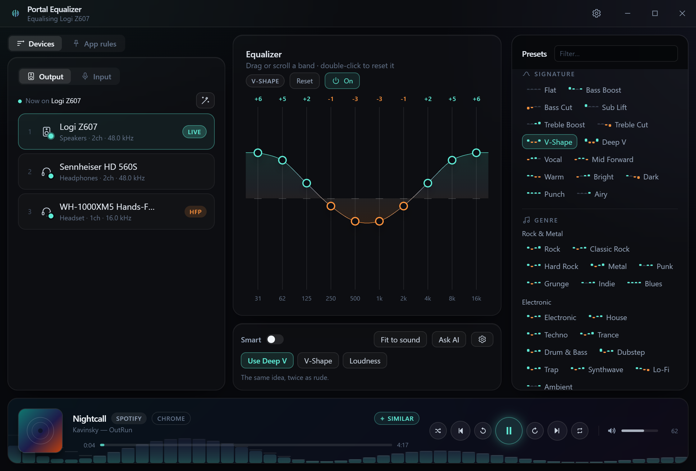
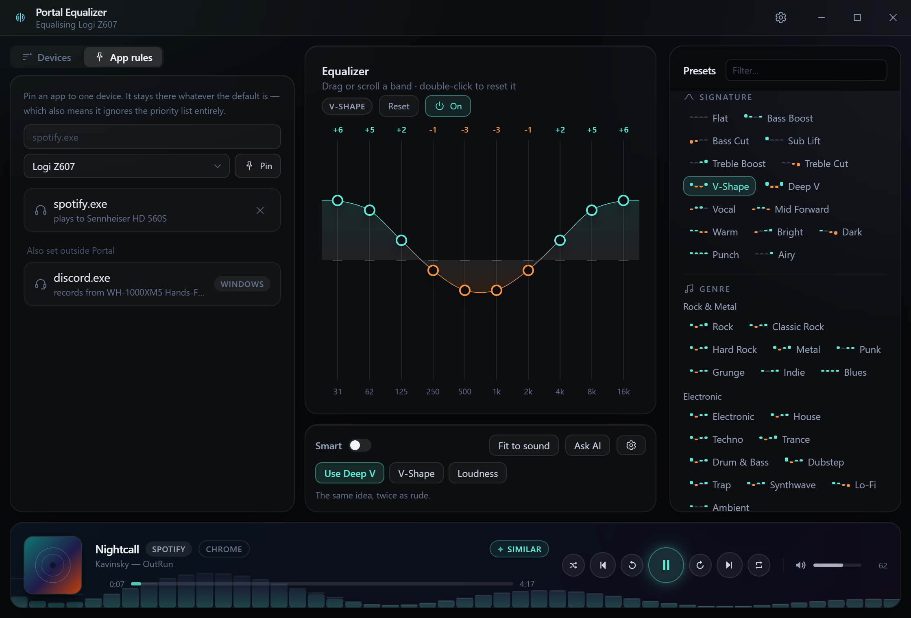
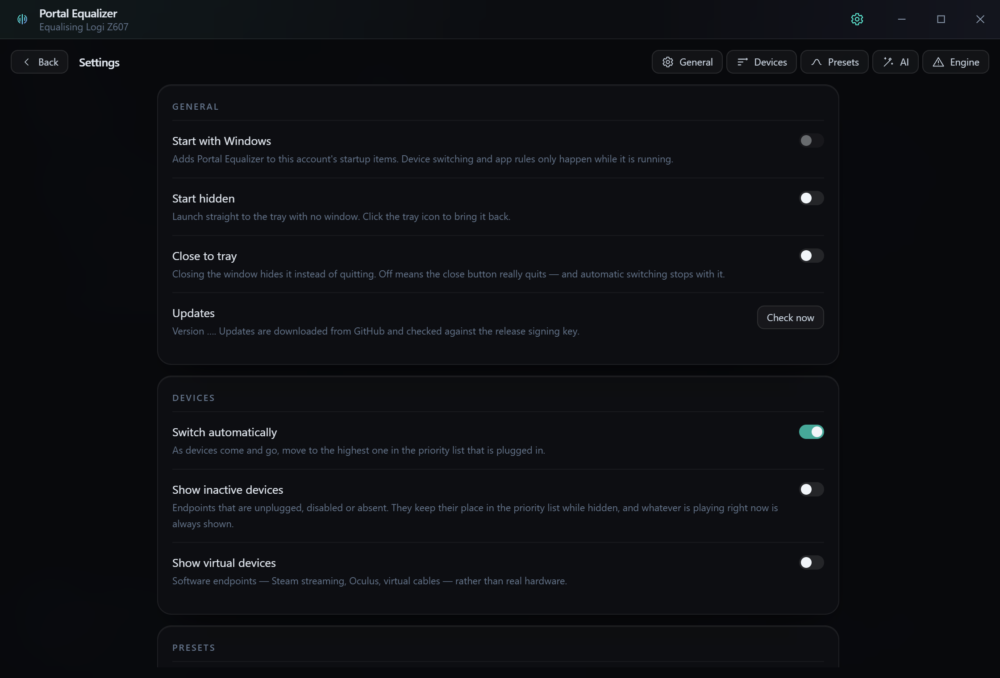
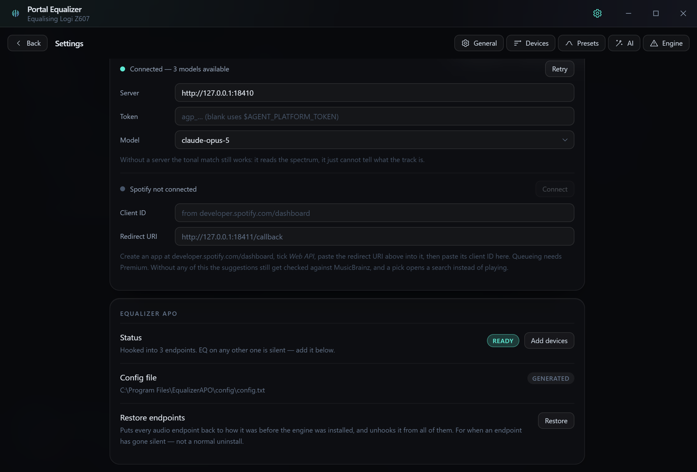

# Portal Equalizer

System-wide EQ, live spectrum, and priority-based audio device switching for Windows.

## What it is

The DSP is not ours. [Equalizer APO](https://sourceforge.net/projects/equalizerapo/)
already does system-wide, per-device, per-channel equalisation at essentially zero
latency cost, and it is driven by a plain text config file. This app generates that
file. What it adds is everything Equalizer APO does not have: a usable interface,
presets, a live analyser, and device switching.

- **10-band EQ per device**, with 85 presets and an automatic clip-safe preamp.
- **Live spectrum** off WASAPI loopback, and a tonal match that suggests a preset
  for whatever is playing.
- **Device switching** by priority, so unplugging headphones falls back the way you
  would have done it by hand.
- **Per-app routing** — pin Spotify to one output and leave the system default alone.

## Installing

Grab the installer from [Releases](../../releases) and run it.

Then open Settings → Engine and press **Install engine**. Equalizer APO's own
installer takes over from there: it needs administrator rights, asks which endpoints
to hook, and wants a reboot afterwards. Builds that ship with the engine bundled
launch it directly; builds that do not open its download page instead, and the panel
says which one you have.

Until an endpoint is hooked, its EQ is silent. The Engine panel says so rather than
letting you wonder, and **Restore** puts every endpoint back the way it was if one
ever goes quiet.

## Screenshots

| | |
|---|---|
|  |  |
| Pin an app to one device | Settings |

## Documentation

- **[Development](docs/development.md)** — running it, the checks, the browser mock,
  releasing.
- **[Architecture](docs/architecture.md)** — module map, how a preset gets picked,
  what the settings actually do, and what was deliberately left out.
- **[Windows audio notes](docs/windows-audio-notes.md)** — the hard-won, non-obvious
  facts about MMDevice, WinRT media sessions and Equalizer APO matching.
- **[Per-app routing](docs/per-app-routing.md)** — the undocumented API behind it.

## Notes

- Your pre-existing `config.txt` is backed up once to `config.portal-backup.txt`
  before we take ownership of it.
- Every audio endpoint's registry state is exported once before the engine installer
  runs, and Settings has a **Restore** for putting it back.
- Settings live in `%APPDATA%\PortalEqualizer\settings.json`.

Equalizer APO is a separate program under its own licence. We ship its installer
unmodified and never link against it.
